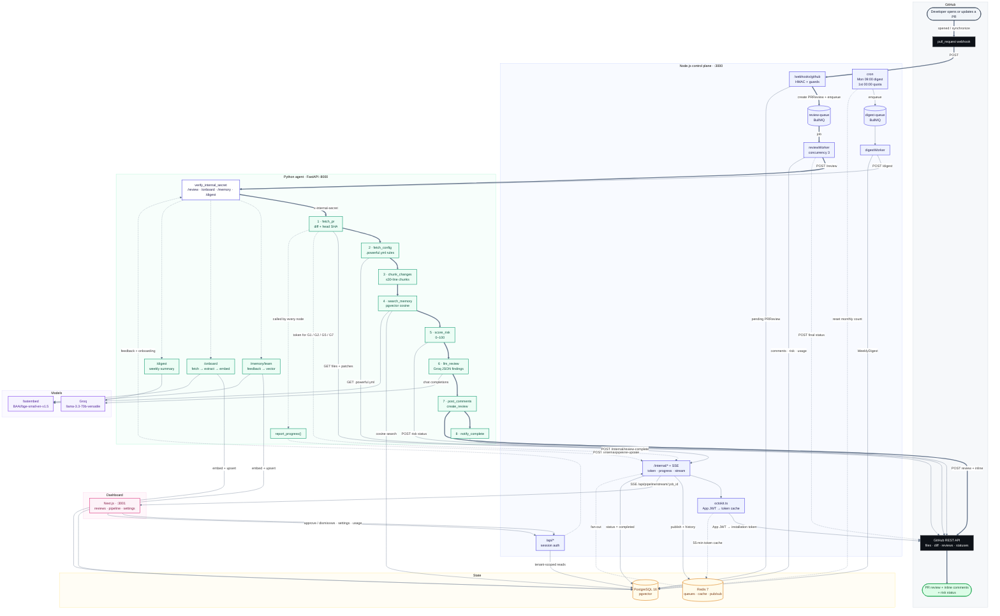

# Architecture

End-to-end architecture of the AI PR Review Agent: from the GitHub webhook to the
review posted back on the pull request, including the control plane, the Python
LangGraph pipeline, persistence, live progress, the feedback loop and the weekly
digest.

## Legend

| Visual | Meaning |
| --- | --- |
| **Thick arrow** | Primary review path: webhook → queue → worker → agent → GitHub. |
| **Thin arrow** | Read or write against GitHub, Postgres or a model. |
| **Dashed arrow** | Control plane: token exchange, progress events, completion, feedback. |
| **Cylinder** | Redis queue/data store or Postgres. |
| **Dark node** | GitHub. |
| **Indigo node** | Node.js control plane. |
| **Green node** | Python agent / LangGraph node. |
| **Amber node** | Shared state (Postgres, Redis). |
| **Violet node** | Model runtime (Groq, fastembed). |
| **Pink node** | Next.js dashboard. |

## End-to-end in one pass

1. GitHub sends a `pull_request` event (`opened` or `synchronize`) to
   `POST /webhooks/github`. The handler verifies the HMAC signature, deduplicates
   on `repo + PR + action + head SHA`, checks the installation, quota, sync
   setting and repo toggle.
2. The handler upserts the organization and repo, creates a `PRReview` row
   (`status: pending`) and enqueues a BullMQ job whose `job_id` is the row id.
3. `reviewWorker` loads the row, computes the team's past dismissal rate and calls
   the Python agent at `POST /review` with `x-internal-secret`.
4. The agent runs the eight-node LangGraph pipeline:
   `fetch_pr → fetch_config → chunk_changes → search_memory → score_risk →
   llm_review → post_comments → notify_complete`.
5. GitHub calls fetch the diff and `.powerful.yml`, post the risk commit status,
   and publish the review with inline comments. The agent gets its installation
   token from the Node API; it never holds the GitHub App private key.
6. Every node calls `report_progress()`, which posts to
   `/internal/pipeline-update`. The Node API publishes the event to Redis,
   keeps a short history, and streams it to the dashboard over SSE at
   `/api/pipeline/stream/:job_id`.
7. Persistence: the worker writes comments, risk score and usage telemetry; the
   agent's `notify_complete` marks the review completed. The dashboard reads
   tenant-scoped data through `/api/*`.
8. Side loops: approve/dismiss feedback goes to `/memory/learn`, historical sync
   goes to `/onboard`, and the Monday cron produces a weekly digest through
   `/digest`, stored in `WeeklyDigest`.

## Details worth calling out

- **Two commit statuses, one context.** `score_risk` posts a status during the
  pipeline, then `reviewWorker` posts a final status after the agent returns,
  using the same `Powerful AI / PR Risk` context. The worker's value is the one
  that wins. The diagram shows both on purpose.
- **Inline-comment fallback.** If GitHub rejects the inline line numbers,
  `post_pull_request_review()` falls back to a plain issue comment. The review is
  still posted, but the inline comments are lost.
- **Memory is repo-scoped.** `search_memory()` filters by `repoId`, not by
  organization, even though entries carry both IDs.
- **Worker concurrency is fixed at 3.** The plan values (1/3/10) shown in the
  dashboard are display-only; the BullMQ worker is constructed with
  `concurrency: 3`.
- **Digest delivery stops at the database.** `digestWorker` stores a
  `WeeklyDigest`; there is no email or Slack client in the dependencies.
- **SSE is mounted outside `/internal`.** The endpoint is
  `/api/pipeline/stream/:job_id`, but it is implemented by the same
  `handlePipelineStream` function that lives in `api/src/routes/internal.ts`.
